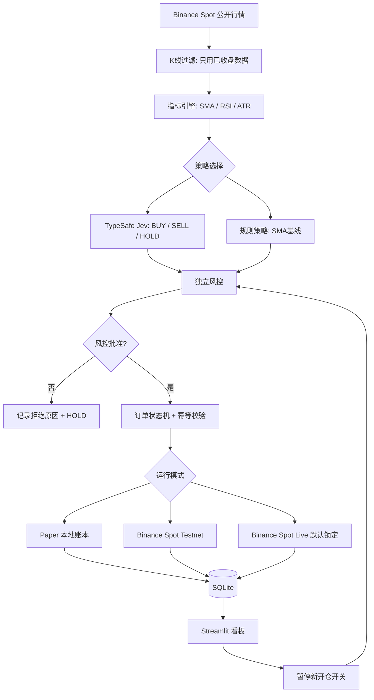
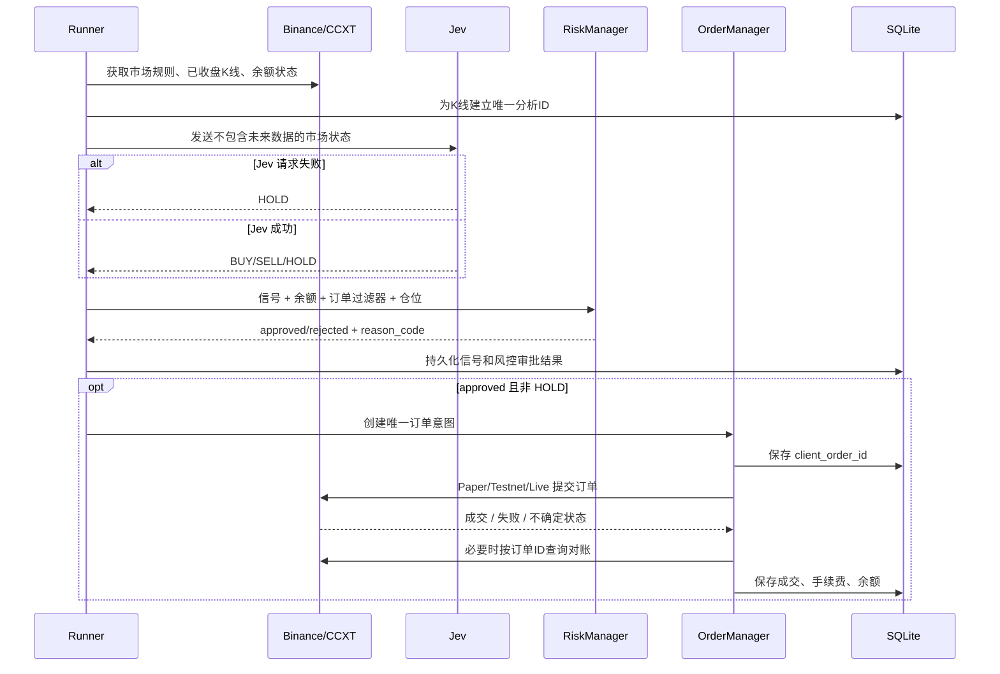
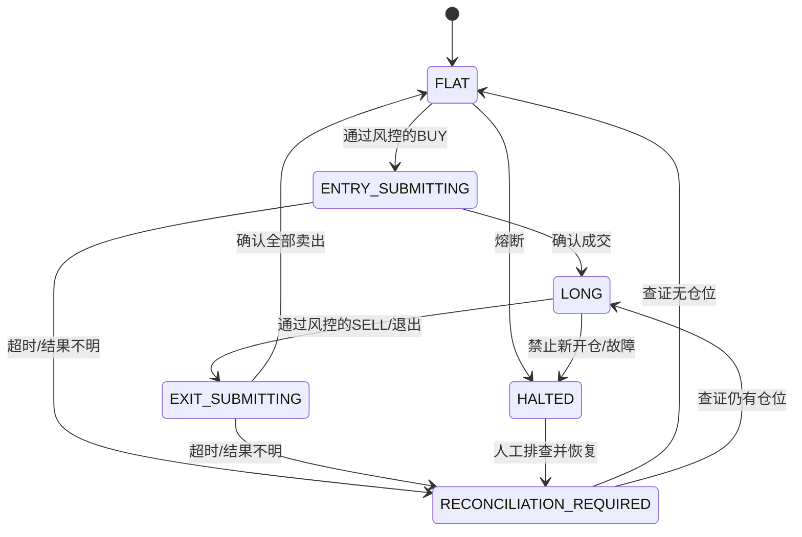

# JevQuant — 项目开发说明与实施计划

> **版本**：v1.0 · **日期**：2026-10-10 · **开发环境**：Windows + Python · **项目状态**：设计稿（尚未实现）  
> **配套机器规范**：[JevQuant.spec](./JevQuant.spec)（YAML 结构，扩展名 `.spec`）

## 0. 项目一句话概括

**JevQuant** 是一个基于 **TypeSafe Jev + 币安现货 BTC/USDT** 的轻量级自动交易研究项目：用真实行情计算指标，由 Jev 生成交易信号，经**独立风控**审批后，由同一套交易接口依次支持 **Paper 模拟盘 → Spot Testnet → 小额现货实盘**。

用户计划用于实际交易的本金上限为 **50 元人民币等值 USDT**，不使用杠杆、不自动充值、不提现。**第一目标是把系统做正确、可测试、可审计；不是承诺让 50 元增值。**

### 成功标准

1. 可以不配置币安私有 API Key，就读取 BTC/USDT 真实公开行情并进行模拟交易。
2. 可以切换规则策略与 Jev 决策，完整保存输入、信号、风控意见、订单和余额变化。
3. 对小资金下单限制、手续费、数量精度、亏损熔断、断网重启和重复下单有自动保护。
4. 至少完成模拟盘与测试网的故障验收，实盘必须再次由用户主动解锁。
5. 通过监控后台观察净值变化、持仓、最近信号、失败原因，且有“暂停新开仓”功能。

## 1. 做什么、不做什么

| MVP 要做 | 明确不做 |
|---|---|
| BTC/USDT 现货，单币种、单仓位 | 合约、杠杆、做空、马丁、自动补仓 |
| 1h 已收盘 K 线、SMA/RSI/ATR | 高频交易、毫秒套利、多币种轮动 |
| Jev 的 BUY / SELL / HOLD 结构化信号 | 给 AI 直接转账/提现/配置风控的权限 |
| 模拟盘、测试网、受限实盘三种模式 | 直接把陌生 GitHub 机器人连接到有资产的 API Key |
| SQLite 审计、自动化测试、简单监控 | 第一版就加入 Vue / FastAPI / MySQL / Kubernetes |

## 2. 为什么自研而不拼接几个完整机器人

开源项目可以复用，但**不要简单地把多个策略执行器并联**。两个执行器如果同时认为自己掌握持仓状态，可能重复买入、撤销对方的订单或误判空仓。

建议采取“**自己写应用层，复用成熟 SDK**”的策略：

| 组件 | 用途 | 首版选择 |
|---|---|---|
| [CCXT](https://github.com/ccxt/ccxt) | 币安行情、交易规则、订单适配 | 直接使用 |
| [TypeSafe Python SDK](https://github.com/typesafe-ai/typesafe-sdk-python) | Jev 结构化决策 | `typesafe-sdk` |
| pandas | 历史行情、技术指标 | 简单公式、单元测试 |
| Python sqlite3 | 模拟资产、订单与审计日志 | 本地 SQLite |
| Streamlit | 本地可视化界面 | 后期接入 |
| pytest | 风控、订单、故障测试 | 从第一阶段开始 |
| [Freqtrade](https://github.com/freqtrade/freqtrade) | 回测/风控设计参考 | 不作为 MVP 依赖 |

推荐 Python 3.11 或 3.12，依赖版本在首次成功运行后锁定。Jev 的官方 Python SDK 使用 `TYPESAFE_API_KEY`，可用 `TypeSafeClient`、`Choice` 和 `client.system_one(...)` 调用。不要把社区网关与官方 TypeSafe 接口混用。

## 3. 系统总体架构



### AI 与交易权限分离

- **Jev 只输出交易方向建议**，不输出可直接执行的 JSON 订单，也不能修改本金和安全阈值。
- **RiskManager 决定是否允许开仓、允许下单多少、是否需要暂停**。不满足最低订单额时拒绝，而不是“试一试”。
- **OrderExecutor 唯一拥有 `create_order` 权限**；UI 和策略代码都不能直接下单。
- **Paper / Testnet / Live 实现统一接口**，但密钥、环境和数据严格隔离。

### 核心时序（每根完整 1h K 线运行一次）



## 4. 50 元本金的资金管理设计

### 4.1 本金与交易对

- **50 元是最多投入的实盘本金**，不是每一笔都购买 50 元的 BTC，也不包含未来追加投资。
- 币安现货交易对的计价货币是 USDT；实盘使用前须由用户手动确认**实际到账 USDT 数量**，写入 `LIVE_INITIAL_CAPITAL_USDT`，且不得高于受限账户可用余额。
- 以前查到过 BTC/USDT 的最低订单名义额约为 **5 USDT**，但**绝不在程序里固定成 5**。交易规则随交易对、时间、接口变化，必须每次启动和下单前查询 `exchangeInfo`。
- 50 元规模一般只能支持很少的订单，不适合网格或拆成多笔小单。手续费、滑点、币价波动和数量舍入有可能造成**买得到却卖不出去**的情况。

### 4.2 最重要的检查：预计能否退出

**开仓前，不仅要判断买单是否合法，还要判断假设币价下跌后是否仍然可能合法卖出**：

1. 获取最新 `MIN_NOTIONAL` / `NOTIONAL`、`LOT_SIZE`、`MARKET_LOT_SIZE` 和交易状态。
2. 按可用 USDT 减去预计手续费、资金缓冲，计算可用买入额度；不超过起始预算上限。
3. 根据数量步长与费用币种估计实际收到的 BTC，**一律用 `Decimal` 精度运算**。
4. 以参考不利价格（例如入场价下跌 3%，再叠加可配置滑点与退出手续费）估算能卖出的名义额。
5. 如果预计卖出不满足最小数量、最小成交额或其他过滤器：**不允许买入**，记 `REJECT_EXIT_MIN_NOTIONAL`。
6. 已持仓时如卖出不满足限制：拒绝盲目重试，暂停新买单并发出人工处理告警。

**特别声明：**上述预检不能保证止损时一定成交。跳空、流动性不足、网络故障、交易所过滤器变更都可能放大亏损。项目不能宣传“最大只亏 3%”。

### 4.3 推荐初始风控（实验参数，不是盈利策略）

| 参数 | MVP 默认 |
|---|---|
| 币种 | BTC/USDT |
| K 线 | 1h 已收盘 |
| 允许最大持仓 | 1 |
| 每个 UTC 日最多新开仓 | 1 |
| 日亏损暂停线 | 初始资产净值的 3% |
| 单笔参考止损 | 3%（非保证） |
| Jev 无响应 | HOLD；但已有仓位继续独立风控 |
| 已有未确认订单 | 禁止新开仓，先对账 |
| 实盘权限 | 默认关闭；启动时双开关 + 命令行确认 |

> 以 50 元本金计算，3% 约为 1.50 元的参考阈值。**这只是触发暂停的策略条件，并不保证亏损上限。**

## 5. 状态机与异常处理



- `signal_id` 固定组合：`symbol + candle_close_utc + strategy_version + action`，避免同一根 K 线重复决策。
- `client_order_id` 对每次交易意图唯一；请求超时不代表交易失败，**只能先查询订单状态，不能立刻再次下单**。
- 启动时必须先和交易所**核对持仓、开放订单及未完成订单**，然后才允许新的买入。
- 部分成交、取消、手续费扣在 BTC/BNB/USDT 等情形，账本都要准确更新。
- `HALTED` 意味着**禁止新增风险敞口**，不意味着停止监控；已有仓位仍需允许合规的风险退出和订单查询。

## 6. 建议项目目录

```text
jevquant/
├─ JevQuant.spec                 # 开发 Agent 应遵守的机器规范
├─ README.md                     # 项目入口说明
├─ .env.example                  # 空密钥模板
├─ .gitignore
├─ pyproject.toml
├─ src/jevquant/
│  ├─ __init__.py
│  ├─ config.py                   # 模式与安全启动门禁
│  ├─ exchange.py                 # 公开行情/Spot Testnet/Live适配
│  ├─ indicators.py               # 技术指标
│  ├─ jev_engine.py               # 官方 TypeSafe SDK
│  ├─ strategy.py                 # AI策略和SMA对照策略
│  ├─ risk.py                     # 50元资金、小额成交额、退出预检
│  ├─ orders.py                   # 订单状态机/幂等/重启恢复
│  ├─ storage.py                  # SQLite与审计日志
│  └─ runner.py                   # 1h收盘触发与工作循环
├─ dashboard/
│  └─ app.py                     # Streamlit仪表盘
├─ tests/
│  ├─ test_exchange_rules.py
│  ├─ test_risk_exit_feasibility.py
│  ├─ test_no_duplicate_orders.py
│  ├─ test_trade_modes.py
│  ├─ test_partial_fills.py
│  └─ test_restart_reconciliation.py
└─ data/                         # 数据库与交易记录，禁止提交
```

## 7. 五阶段实施路线

| 阶段 | 先交付什么 | 完成标准 |
|---|---|---|
| **P1 行情与项目骨架** | Python 项目、CCXT、BTC/USDT 行情、交易过滤器、SQLite | 无任何 API Key 也能运行，显示真实行情与动态限制 |
| **P2 策略与 Jev** | SMA/RSI/ATR、TypeSafe SDK、BUY/SELL/HOLD、SMA 基线 | 只使用已收盘K线；调用失败自动 HOLD；可比较两种信号 |
| **P3 模拟交易** | Paper 账户、手续费/滑点/精度、小额退出预检、风控与 UI | pytest 通过；7–14 天模拟运行观察稳定性，不视作收益证明 |
| **P4 Spot Testnet** | 独立测试密钥、真实 API 下单与状态恢复、故障注入 | 测过断网、部分成交、重复重试和测试网重置 |
| **P5 受限实盘** | 独立 Live Key、双开关及 CLI 确认、预检、一键暂停 | 人工再次授权后才能启用；余额、权限、额度、最小下单额全部复核 |

### 阶段 P1：可立即开始的步骤

在 **PowerShell** 中创建工程：

```powershell
mkdir JevQuant
cd JevQuant
py -3.11 -m venv .venv
.\.venv\Scripts\python.exe -m pip install --upgrade pip
.\.venv\Scripts\python.exe -m pip install ccxt pandas typesafe-sdk streamlit pytest python-dotenv
```

> 如果没有 Python 3.11，可先运行 `py -0p` 查看已安装的版本，并使用兼容的 3.10+ 版本；遇到依赖不兼容时按锁定版本处理。

最简单的公开行情读取程序（**无权限交易**）：

```python
# market_probe.py — 只读取公开数据
import ccxt

exchange = ccxt.binance({"options": {"defaultType": "spot"}, "enableRateLimit": True})
market = exchange.load_markets()["BTC/USDT"]
ticker = exchange.fetch_ticker("BTC/USDT")
print("BTC/USDT last price:", ticker.get("last"))
for rule in market["info"].get("filters", []):
    if rule.get("filterType") in {"MIN_NOTIONAL", "NOTIONAL", "LOT_SIZE", "MARKET_LOT_SIZE"}:
        print(rule)
```

运行：

```powershell
.\.venv\Scripts\python.exe market_probe.py
```

如果连接因地理位置/服务限制失败，**先核查你当前币安账户所在地区与官方接口是否可用**，不要为绕过限制而修改交易终端。

### 阶段 P2：Jev 适配器的最小调用形式

下方展示官方 SDK 的**结构示例**；在未配置真实 API Key 时不调用付费模型，使用 Mock 测试或 SMA 基线：

```python
from typesafe_sdk import Choice, TypeSafeClient

state = {
    "symbol": "BTC/USDT",
    "timeframe": "1h",
    "close": 100000,          # 仅示意数据，非实时价格
    "sma20": 99800,
    "sma60": 99200,
    "rsi14": 55.0,
    "has_position": False,
}

with TypeSafeClient() as client:  # 从 TYPESAFE_API_KEY 读取密钥
    response = client.system_one(
        state=state,
        questions={
            "action": Choice(
                instructions="基于给定的历史市场状态选择下一周期的研究信号；不决定金额或交易权限。",
                criteria={"BUY": None, "SELL": None, "HOLD": None},
            )
        },
    )
    action = response.choices["action"].choice
    assert action in {"BUY", "SELL", "HOLD"}
    print(action)
```

模型输出不是买卖许可证；真正开仓前一定经过 `RiskManager`。

## 8. 开发 Agent 分工（Codex 可直接照此执行）

| Agent | 负责 | 不得越权 |
|---|---|---|
| **架构/集成 Agent** | 搭建项目、接口抽象、配置、SQLite 与 CI | 不开启实盘交易 |
| **行情/策略 Agent** | 公开行情、K线过滤、指标、Jev、SMA 基线 | 不调用 `create_order` |
| **风控/订单 Agent** | 最低金额、Decimal、卖出可行性、幂等、对账 | 不允许模型绕过风控 |
| **测试/审查 Agent** | pytest、Mock、故障注入、权限与密钥审计 | 不以模拟收益冒充真实收益 |
| **UI Agent（后续）** | Streamlit 看板、状态与告警、暂停按钮 | 不展示 Key/Secret，不直接生成交易指令 |

### 给 Codex 的第一条开发任务（可直接复制）

```text
请以 JevQuant.spec 为最高优先级项目规范、以 JevQuant-开发计划.md 为设计参考，实现 P1：
1. 创建 Python src-layout 项目与 pyproject.toml、.gitignore、.env.example。
2. 使用 CCXT 读取 BTC/USDT 公共现货行情、已收盘1h K线、exchangeInfo过滤器。
3. 使用 Decimal 规范化交易规则；实现 SQLite 的 market_rules_snapshots 表。
4. 添加 pytest：无密钥可启动、模拟行情、交易对被暂停、过滤器缺失时拒绝继续。
5. 不创建任何私有币安下单调用；不请求真实 API Key；不要实现 Live。
6. 交付运行命令、测试报告、已实现清单和下一步。
发现 spec 与实现冲突时先修正文档，不要降低风控约束。
```

## 9. 关键验收清单（未全部通过禁止实盘）

- [ ] 已验证所在地区、账户和币安现货 API 符合适用要求。
- [ ] 无私有币安 API Key 可以完整运行 Paper 模式；默认没有真实订单能力。
- [ ] 每根收盘 K 线最多生成一次信号，历史数据无未来函数。
- [ ] BTC/USDT 实际过滤器是**动态查询**，不是硬编码 5 USDT。
- [ ] 买入前检查预测卖出可行性，并考虑手续费、滑点和数量舍入。
- [ ] 订单超时、不确定状态、部分成交和程序重启均可安全对账。
- [ ] Jev 失败自动 HOLD，不让模型决定订单金额和账户权限。
- [ ] 单日亏损触发时暂停新开仓；已有仓位继续监控/合规退出。
- [ ] Testnet 使用单独密钥与数据库；通过真实下单、取消、查询测试。
- [ ] Live 需要 `TRADING_MODE=live` + `ENABLE_LIVE_TRADING=true` + CLI `--confirm-live`。
- [ ] API Key 只具备必要的只读/现货交易权限，无提现/合约权限；尽可能 IP 限制。
- [ ] 日志、控制台、Git 仓库中无密钥和 Secret 泄漏。
- [ ] 已使用足够的历史数据评估含手续费净收益，并与不使用 Jev 的策略对照。

## 10. 风险、成本和现实预期

- **本金极小**：不宜预期绝对收益可观，可能因最低订单额而无法执行计划中的全部交易。
- **模型并不保证有效**：即使 Jev 能快速提供结构化判断，也不代表其预测优于随机选择或 SMA 基线；用净值、回撤、胜率、交易次数和成本评估。
- **API 调用成本与交易本金分开**：真实 Jev 调用可能产生费用，月度上限先从小额预算开始设置；没有上限不调用付费服务。
- **止损并不保本**：无法保证按设定价成交；最低卖出名义额约束对 50 元本金尤其重要。
- **环境隔离**：币安现货测试网资金为虚拟资产、可能定期重置；测试网表现不代表实盘收益。
- **密钥管理**：切勿把真实 API Key 粘贴给编码 Agent、提交到 GitHub，或给未知开源程序提现权限。
- **交易地区限制**：币安全球站、Binance.US 与不同司法辖区的服务可用性不同，必要时应停止而不是绕过限制。

## 11. 官方资料与参考项目

1. [TypeSafe 官方 Python SDK](https://github.com/typesafe-ai/typesafe-sdk-python) — `typesafe-sdk`、`TYPESAFE_API_KEY`、`TypeSafeClient` / `Choice`。
2. [Binance Spot API 官方文档](https://github.com/binance/binance-spot-api-docs) — API、手续费咨询渠道、交易约束与密钥安全。
3. [Binance 交易过滤器](https://github.com/binance/binance-spot-api-docs/blob/master/filters.md) — `MIN_NOTIONAL`、`NOTIONAL`、`LOT_SIZE` 等。
4. [Binance Spot Testnet 说明](https://github.com/binance/binance-spot-api-docs/blob/master/testnet/general-info.md) — 测试端点、余额和周期性重置。
5. [CCXT Binance 接口](https://docs.ccxt.com/docs/exchanges/binance) — 行情、下单参数与交易所适配。
6. [Freqtrade](https://github.com/freqtrade/freqtrade) — 研究其回测与风险控制思路；不是首版必装依赖。

---

**下一步**：把两份文件放在同一个 `JevQuant/` 根目录，先把第 7 节的 P1 任务交给 Codex。等 P1 完成且能无密钥读取公开行情后，再进入 Jev 决策开发。不要直接从设计阶段跳到实盘。
