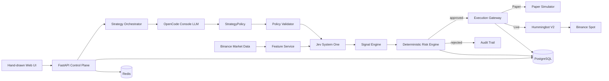
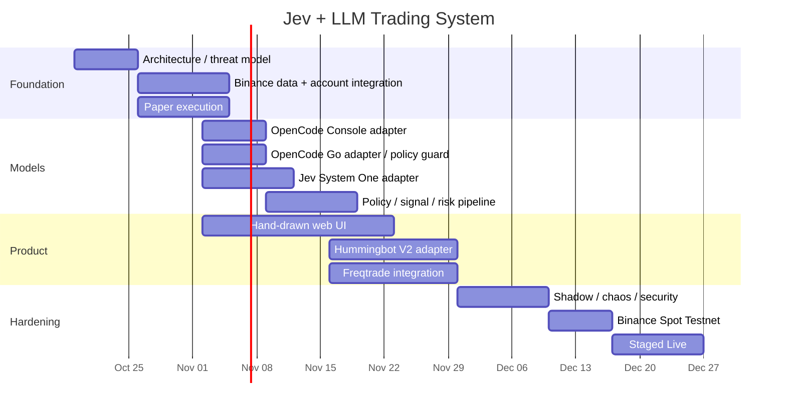
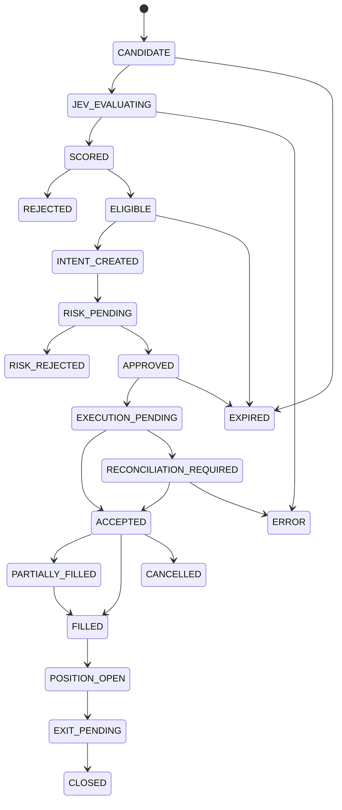
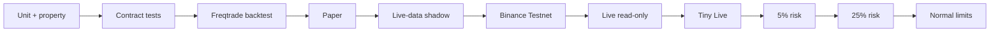

# Jev + LLM Dual-Model Binance Trading System

**Research date:** October 17, 2026  
**Target:** Binance Spot first; Paper + Live; OpenCode Console + OpenCode Go/Claude Code; Jev System One; Hummingbot V2 execution; Freqtrade backtesting; hand-drawn editorial web UI.

Canonical project artifacts:

- [Download `plan.md`](sandbox:/mnt/data/plan.md)
- [Download `spec.md`](sandbox:/mnt/data/spec.md)

## Executive summary

The architecture is viable, but the most important research finding changes one part of the original idea:

> **Use OpenCode Console as the production model plane for automated trading. Integrate OpenCode Go as a supported connection, but do not use Go by default for unattended trading-runtime inference.**

OpenCode Go currently costs **$10/month** and Go Plus **$40/month**, exposes direct inference endpoints, and explicitly supports clients including **Claude Code**. However, OpenCode's current documentation says Go is designed for OpenCode and other **coding agents producing similar request types**; clients are expected to send typical coding-agent traffic, identify themselves with an appropriate user-agent, and maintain a stable session identifier. Therefore, continuously sending market snapshots to Go for automated trade decisions would be a questionable fit with its documented intended usage. citeturn17view0turn18view1

OpenCode Console is a much cleaner production integration surface. It supports service accounts, Bearer API keys, an **Inference only** permission, budgets, workspace controls, and direct inference APIs. More importantly for this project, Console currently exposes **Jev 1.13** directly through its System One inference endpoint, alongside LLMs. citeturn18view3turn20search2

The recommended control hierarchy is therefore:

```text
LLM
 │
 │ generates a bounded StrategyPolicy
 ▼
Policy Validator + Server Risk Envelope
 │
 │ defines what Jev is permitted to consider
 ▼
Jev
 │
 │ independently searches/evaluates opportunities
 ▼
TradeIntent
 │
 ▼
Deterministic Risk Engine
 │
 ├── reject
 │
 └── approve
       │
       ▼
Execution Gateway
       │
       ├── Paper Simulator
       │
       └── Hummingbot V2
                │
                ▼
             Binance
```

This preserves your original idea—**LLM determines the strategic operating envelope, while Jev independently decides whether an individual opportunity deserves execution**—without allowing either AI model to directly possess Binance credentials or bypass hard risk controls.

TypeSafe's current System One API is particularly compatible with this role because it accepts a `state` and one or more typed questions and returns typed decisions. Current documented types include `noul`, `choice`, and `score`; multiple questions can be evaluated in one call. OpenCode currently lists Jev at **$0.042 per million input tokens with output free**. citeturn20search2turn20search3turn20search4

The resulting production design should have three logical environments even though the normal UI can emphasize two:

| Environment | Purpose | Real funds |
|---|---|---:|
| **Paper** | Local deterministic simulator | No |
| **Testnet** | Binance integration validation before production | No |
| **Live** | Real Hummingbot → Binance execution | Yes |

Binance provides Spot Testnet APIs, while its production API publishes dynamic request-weight/order limits and usage headers. A resilient implementation should discover and react to those limits instead of embedding a single static “requests per minute” value. Binance documents HTTP `429` throttling, `Retry-After`, and `418` IP-ban behavior for repeated violations. citeturn18view5turn19search26

The other major architectural decision is to treat **models as advisers inside a deterministic transaction system**, rather than as autonomous exchange agents. The LLM does not submit orders; Jev does not submit orders; only the Risk Engine can authorize an immutable `TradeIntent`, and only the Execution Gateway can route that intent.



The architecture is also aligned with Hummingbot V2. Its current Strategy V2 design separates finite **Executors**, which own discrete trading workflows, from long-running **Controllers**, which orchestrate executors. Executors can be created directly through the API; a PositionExecutor can manage stop-loss, take-profit, time-limit and trailing-stop behavior. citeturn18view7turn20search8

## Research findings and system decisions

**OpenCode Go versus Console**

| Area | OpenCode Go / Go Plus | OpenCode Console | Recommendation |
|---|---|---|---|
| Billing | $10/month / $40/month subscription | PAYG / connected providers | Console for runtime |
| Intended workload | Coding-agent traffic | Integration/inference service | **Console** |
| Claude Code | Validated Go client | Can use underlying inference independently | Go useful for developer workflows |
| Direct API | Yes | Yes | Both adapters |
| Jev | Not in current Go catalog | Jev 1.13 System One | **Console for Jev** |
| Workspace | Go subscription is single-member | Workspace/service-account model | Console |
| Service account | Not the primary Go model | Yes | Console |
| Least-privilege inference credential | N/A in same sense | `Inference only` | Console |
| Usage control | Model-specific 5-hour/weekly/monthly limits | Budgets and PAYG | Console |
| Excess usage | Can optionally fall back to Console balance | Native PAYG | Console |
| Data handling | Model-specific retention/training | Console has its own model privacy policy | Inspect per selected model |
| Trading-runtime policy | Poor fit with stated intended traffic | Appropriate technical integration path | **Console** |

OpenCode says Go limits are model-specific and currently use 5-hour, weekly and monthly windows; included usage and available models can change. It also documents direct OpenAI Responses, Anthropic, Google and OpenAI-compatible endpoints, plus a model-discovery endpoint. citeturn17view0turn18view0turn18view1

Go privacy also varies by model. Current documentation shows some models at zero retention, others at 30 days, and contributor models for which requests may be used for training. This should become a **machine-readable safety property in the Models page**, rather than something hidden in deployment documentation. citeturn18view2

Console, by contrast, supports service accounts and allows the application to use an **Inference only** key rather than an administrative key. citeturn18view3

One terminology distinction is worth making explicit: **Claude Code is a coding-agent client, not the model layer itself**. OpenCode Go specifically lists Claude Code as a validated client and recognizes its native session information. The backend architecture should consequently model these independently:

```text
Client:
  OpenCode
  Claude Code
  Web UI
  Backend Worker

Inference channel:
  OpenCode Go
  OpenCode Console
  Direct TypeSafe (optional)

Model:
  selected LLM
  Jev
```

That prevents the implementation from coupling “Claude Code support” to a particular LLM model. citeturn17view0

**Recommended model-routing policy**

```yaml
model_usage_policy:
  opencode_go:
    coding_agent: allow
    strategy_authoring: allow
    trade_runtime: deny
    backtest_analysis: deny

  opencode_console:
    coding_agent: allow
    strategy_authoring: allow
    trade_runtime: allow
    backtest_analysis: allow

  typesafe_direct:
    jev_runtime: optional
```

The backend should make the Go restriction a server-side `purpose` check. It should **not** be a frontend-only warning.

A future override could be enabled after receiving explicit OpenCode confirmation that the specific automated market-analysis workload is acceptable. Until then, the clean configuration is:

```text
OpenCode Go API key
        │
        ├── Claude Code / OpenCode coding session
        └── Strategy-writing assistant

OpenCode Console API key
        │
        ├── Runtime LLM strategy analysis
        └── Jev System One

Binance key
        │
        └── Hummingbot / execution service only
```

**Jev's role**

The best use of Jev here is not “tell me what the market is doing in prose.” That is the LLM's job.

Jev should instead answer bounded, machine-oriented questions such as:

```text
Does this candidate satisfy the current strategy?
Which action is best: buy / wait / reject?
How strong is this setup?
What probability do you assign to policy fit?
```

The TypeSafe API is designed around exactly this `state + typed questions` pattern. Its documented API supports multiple questions in the same request, with answers returned using the corresponding question IDs. citeturn20search2turn20search3

The fundamental decision path becomes:

```text
LLM:
"BTC longs are permitted under these conditions for the next 60 minutes."

              ↓

Jev every candidate/event:
"Does THIS BTC snapshot deserve a long entry?"

              ↓

Risk engine:
"Even if Jev says yes, is it legal under account-level constraints?"

              ↓

Execution:
"Turn approved intent into exchange state."
```

That is substantially safer and easier to backtest than asking an LLM to issue arbitrary exchange instructions.

## plan.md

[Download the full `plan.md`](sandbox:/mnt/data/plan.md)

The canonical project plan assumes **Binance Spot**, one trading account for the first release, and approximately four FTE of engineering capacity. Team size and budget were not supplied, so schedule estimates should be treated as planning assumptions rather than commitments.

**Milestones**

| Window | Milestone | Owner | Main deliverables | Acceptance gate |
|---|---|---|---|---|
| Week 1 | Architecture and threat model | Backend/Quant Lead + SRE | ADRs, schemas, state machine, threat model | Models cannot access exchange credentials; hard limits defined |
| Weeks 1–2 | Binance data plane | Backend/Integration | WebSocket/REST ingestion, filters, account read path | stale-feed detection and reconnect pass |
| Weeks 2–3 | Paper engine | Backend/Quant | simulated orders/fills/PnL | Paper uses same intent contract as Live |
| Weeks 3–4 | Model plane | Backend/Integration | Console LLM, Go adapter, Jev adapter | Go purpose guard works; invalid model output cannot trade |
| Weeks 4–5 | Signal + risk pipeline | Backend/Quant Lead | policy compiler, Jev gate, risk service | server limits always dominate model limits |
| Weeks 3–6 | Web UI | Frontend | eight core pages | persistent mode indicator and server-controlled Live mode |
| Weeks 5–7 | Hummingbot/Freqtrade | Backend/Quant | execution adapter and backtest harness | one intent → one executor; reproducible backtest |
| Weeks 7–8 | Shadow/security hardening | QA/SRE | fault injection, telemetry, audit | all major dependency failures fail safely |
| Weeks 8–9 | Binance Testnet | Backend/QA | exchange staging | full order lifecycle/reconciliation passes |
| Weeks 9–10 | Staged Live | Lead/SRE | tiny-notional rollout | kill switch, rollback and reconciliation proven |

Hummingbot's current stable client release found during this research is **v2.17.0**, released September 22, 2026. Hummingbot also notes that some related repositories such as Hummingbot API follow continuous deployment, so production should pin image digests or commit hashes rather than consume a floating `latest`. citeturn19search7turn19search9

**Timeline**



**Definition of done**

The system should not be considered Live-capable merely because it can place a Binance order. The acceptance threshold should be much stricter:

1. Every LLM policy validates against a strict schema and has an expiry.
2. Server-side limits can reduce model-proposed limits but can never be enlarged by a model.
3. Jev has no Binance credential.
4. The LLM has no Binance credential.
5. Paper and Live consume identical `TradeIntent` objects.
6. Duplicate intent delivery cannot produce duplicate economic action.
7. Live arming occurs on the server, not through a browser boolean.
8. A withdrawal-enabled Binance key is rejected by application policy.
9. Every model/risk/order/fill transition is auditable.
10. Unknown order status becomes `RECONCILIATION_REQUIRED`, not “retry buy.”
11. Model/data/DB failures prevent new risk.
12. Existing positions retain deterministic exit management whenever the execution layer remains healthy.
13. Shadow mode and Binance Testnet pass before Live.
14. A rollback drill succeeds before significant capital limits are enabled.

Binance exposes an API-permission endpoint that reports fields including `ipRestrict`, `enableReading`, `enableWithdrawals`, and `enableSpotAndMarginTrading`, so these Live preflight checks can be programmatic rather than relying only on operator declarations. citeturn20search7

## spec.md

[Download the full `spec.md`](sandbox:/mnt/data/spec.md)

**Service architecture**

```text
Browser
   │
   ▼
FastAPI Control Plane
   │
   ├── Authentication / RBAC
   ├── Mode Manager
   ├── Strategy Orchestrator
   ├── Risk Configuration
   ├── Audit API
   └── WebSocket UI events
          │
          ├──────── PostgreSQL
          └──────── Redis

Market Data Service
   │
   ▼
Feature Worker
   │
   ▼
Candidate Stream
   │
   ▼
Jev Worker
   │
   ▼
Signal Engine
   │
   ▼
Risk Worker
   │
   ▼
Approved TradeIntent
   │
   ▼
Execution Gateway
   ├── Paper Engine
   └── Hummingbot V2
          │
          ▼
       Binance
```

PostgreSQL should be the authoritative financial/event store. Redis Streams are appropriate for worker fan-out and at-least-once queue semantics because consumer groups support explicit acknowledgments and pending-entry recovery, but an approved order/intent/fill should never exist **only** in Redis. citeturn21search23turn21search34

### LLM strategy contract

The LLM receives account-safe derived state, market summaries and hard server limits. It does **not** receive Binance/OpenCode keys.

Example input:

```json
{
  "request_id": "0f95b4d2-fc3e-48c2-a120-b24bbda6046b",
  "as_of": "2026-10-17T18:00:00Z",
  "mode": "paper",
  "account_state": {
    "equity_usdt": 10000.0,
    "available_quote_usdt": 8000.0,
    "open_positions": 1,
    "daily_realized_pnl_pct": -0.20
  },
  "market_summary": {
    "universe": ["BTCUSDT", "ETHUSDT", "SOLUSDT"],
    "timeframes": ["1m", "5m", "1h"],
    "feature_snapshot_ids": [
      "snap_btc_xxx",
      "snap_eth_xxx",
      "snap_sol_xxx"
    ]
  },
  "absolute_server_limits": {
    "max_position_notional_usdt": 500,
    "max_gross_exposure_pct": 20,
    "max_daily_loss_pct": 2,
    "max_positions": 3
  },
  "required_schema_version": "strategy-policy/1.0"
}
```

Expected output:

```json
{
  "schema_version": "strategy-policy/1.0",
  "policy_id": "97a55535-d327-4145-a540-d9bb33259d56",
  "generated_at": "2026-10-17T18:00:12Z",
  "expires_at": "2026-10-17T19:00:12Z",
  "mode_scope": ["paper", "live"],
  "regime": {
    "label": "range",
    "confidence": 0.74,
    "notes": "Prefer selective mean-reversion entries."
  },
  "universe": [
    {
      "symbol": "BTCUSDT",
      "allowed_sides": ["BUY"],
      "max_position_notional_usdt": 300,
      "max_spread_bps": 4,
      "max_slippage_bps": 8,
      "entry_cooldown_seconds": 900
    }
  ],
  "portfolio": {
    "max_gross_exposure_pct": 12,
    "max_positions": 2,
    "max_daily_loss_pct": 1,
    "max_drawdown_pct": 2.5
  },
  "jev_gate": {
    "entry_choice": "buy",
    "min_choice_probability": 0.72,
    "min_policy_fit": 0.90,
    "min_quality_score": 3.0
  },
  "exit_defaults": {
    "stop_loss_bps": 70,
    "take_profit_bps": 120,
    "max_holding_seconds": 14400
  },
  "invalidation": [
    "market_data_stale",
    "spread_above_policy",
    "daily_loss_limit_hit",
    "policy_expired"
  ],
  "rationale": "Prefer selective longs while the market remains range-bound."
}
```

The crucial rule is:

```python
effective_limit = min(
    llm_proposed_limit,
    account_hard_limit,
    environment_limit,
    symbol_limit,
)
```

The LLM may **narrow** risk but never expand the server envelope.

A simplified policy JSON Schema is:

```json
{
  "$schema": "https://json-schema.org/draft/2020-12/schema",
  "$id": "strategy-policy/1.0",
  "type": "object",
  "additionalProperties": false,
  "required": [
    "schema_version",
    "policy_id",
    "generated_at",
    "expires_at",
    "mode_scope",
    "regime",
    "universe",
    "portfolio",
    "jev_gate",
    "exit_defaults",
    "invalidation",
    "rationale"
  ],
  "properties": {
    "schema_version": {
      "const": "strategy-policy/1.0"
    },
    "policy_id": {
      "type": "string",
      "format": "uuid"
    },
    "generated_at": {
      "type": "string",
      "format": "date-time"
    },
    "expires_at": {
      "type": "string",
      "format": "date-time"
    },
    "mode_scope": {
      "type": "array",
      "items": {
        "enum": ["paper", "live"]
      }
    },
    "regime": {
      "type": "object",
      "required": ["label", "confidence"],
      "properties": {
        "label": {
          "enum": [
            "risk_on",
            "risk_off",
            "trend",
            "range",
            "high_vol",
            "uncertain"
          ]
        },
        "confidence": {
          "type": "number",
          "minimum": 0,
          "maximum": 1
        }
      }
    },
    "jev_gate": {
      "type": "object",
      "required": [
        "entry_choice",
        "min_choice_probability",
        "min_policy_fit",
        "min_quality_score"
      ]
    }
  }
}
```

### Jev request and response

OpenCode Console currently documents Jev 1.13 using its System One endpoint and supports `noul`, `choice` and `score` questions. Multiple questions can be submitted together. citeturn20search1turn20search2

A trading evaluation could therefore look like:

```json
{
  "model": "jev-1.13",
  "state": {
    "symbol": "BTCUSDT",
    "timestamp": "2026-10-17T18:14:05.224Z",
    "policy_id": "97a55535-d327-4145-a540-d9bb33259d56",
    "mid": 68122.41,
    "spread_bps": 1.8,
    "return_1m_bps": -8.3,
    "return_5m_bps": -21.0,
    "rsi_5m": 31.4,
    "atr_5m_bps": 42.7,
    "orderbook_imbalance_10": 0.18,
    "volume_z_5m": 1.3,
    "distance_vwap_5m_bps": -28.6,
    "policy": {
      "allowed_sides": ["BUY"],
      "max_spread_bps": 4,
      "entry_style": "selective range mean reversion"
    }
  },
  "questions": {
    "entry_action": {
      "type": "choice",
      "instructions": "Choose whether this snapshot merits a new entry under the supplied policy.",
      "criteria": {
        "buy": "A BUY entry is justified now.",
        "wait": "The setup may be valid but timing is insufficient.",
        "reject": "The setup should not be traded."
      }
    },
    "entry_quality": {
      "type": "score",
      "instructions": "Score setup quality.",
      "criteria": [
        "invalid",
        "weak",
        "acceptable",
        "strong",
        "exceptional"
      ]
    },
    "policy_fit": {
      "type": "noul",
      "instructions": "Probability that this opportunity fits the active policy."
    }
  }
}
```

The provider-specific response should be validated against the current API and normalized internally to something like:

```json
{
  "model": "jev-1.13.0",
  "evaluation_id": "jev_5d9a...",
  "answers": {
    "entry_action": {
      "type": "choice",
      "choice": "buy",
      "confidence": 0.86,
      "probabilities": {
        "buy": 0.78,
        "wait": 0.19,
        "reject": 0.03
      }
    },
    "entry_quality": {
      "type": "score",
      "score": 3.2
    },
    "policy_fit": {
      "type": "noul",
      "noul": 0.97
    }
  },
  "usage": {
    "input_tokens": 724
  }
}
```

TypeSafe's API documentation says available models should be discovered through `GET /v1/models`; its current docs expose the `jev-latest` alias. For reproducible trading experiments, recording the **resolved model revision** rather than merely the alias is important. citeturn20search3

TypeSafe has also recently announced Jev 1.14 and experimental capabilities. Those “danger-zone” features should stay outside the first trading release; model changes should go through replay/shadow validation before promotion. citeturn20search0

### TradeIntent schema

The model decision must be transformed into a deterministic intermediate object before execution:

```json
{
  "schema_version": "trade-intent/1.0",
  "intent_id": "5241d47c-53d0-412f-80a2-f3bbfa70e8ff",
  "signal_id": "ddcc2243-b4f3-45d1-84a2-86d575219322",
  "policy_id": "97a55535-d327-4145-a540-d9bb33259d56",
  "mode": "paper",
  "account_id": "a1380291-ceba-445e-980f-c2361904ca31",
  "symbol": "BTCUSDT",
  "side": "BUY",
  "intent_type": "OPEN",
  "order_preference": "LIMIT",
  "quote_notional": 250.0,
  "max_slippage_bps": 8,
  "limit_price": 68120.0,
  "stop_loss_bps": 70,
  "take_profit_bps": 120,
  "created_at": "2026-10-17T18:14:05.500Z",
  "expires_at": "2026-10-17T18:14:20.500Z",
  "idempotency_key": "intent-5241d47c-53d0-412f",
  "risk_snapshot_hash": "sha256:...",
  "provenance": {
    "llm_model": "configured-console-model",
    "jev_model": "jev-1.13",
    "jev_evaluation_id": "jev_5d9a..."
  }
}
```

No model output should ever contain exchange secrets or a raw “call Binance now” instruction that bypasses this object.

### Signal lifecycle



Every state transition should be an append-only event in addition to updating the latest-state projection.

### Failure behavior

The failure policy is deliberately asymmetric:

| Failure | New entries | Existing positions |
|---|---|---|
| LLM timeout | use existing policy only until original expiry | continue |
| Policy expired | **blocked** | manage exits |
| Invalid LLM JSON | **blocked** | manage exits |
| Jev unavailable | **blocked** | manage exits |
| Market feed stale | **blocked** | exchange/Hummingbot exit protection |
| PostgreSQL unavailable | **blocked** | keep execution-side protections |
| Redis unavailable | **blocked** | existing execution remains |
| Hummingbot unavailable | **blocked** | reconcile before rearm |
| Binance 429 | throttle/back off | continue carefully |
| Binance 418 | **disarm Live entries** | reconcile/monitor |
| Unknown order result | no blind retry | reconciliation required |

Binance explicitly exposes current usage through request-weight headers and directs clients to use `Retry-After` on throttling/ban responses, supporting this adaptive rather than hard-coded approach. citeturn19search26

### FastAPI API

Recommended surface:

| Method | Endpoint | Role |
|---|---|---|
| `POST` | `/api/v1/connections/opencode/test` | test Console/Go key |
| `GET` | `/api/v1/connections/opencode/models` | current inventory |
| `POST` | `/api/v1/connections/binance/test` | key/permission/account preflight |
| `GET` | `/api/v1/system/status` | safe-state/dependencies |
| `POST` | `/api/v1/mode/arm-live` | server Live arming |
| `POST` | `/api/v1/mode/disarm` | stop new entries |
| `POST` | `/api/v1/kill-switch` | emergency action |
| `POST` | `/api/v1/strategy/policies/generate` | refresh policy |
| `GET` | `/api/v1/strategy/policies/current` | active policy |
| `GET` | `/api/v1/signals` | Jev signal feed |
| `POST` | `/api/v1/execution/intents` | internal intent submission |
| `GET` | `/api/v1/orders` | orders |
| `GET` | `/api/v1/positions` | positions |
| `GET` | `/api/v1/pnl` | PnL |
| `POST` | `/api/v1/backtests` | Freqtrade job |
| `GET` | `/api/v1/backtests/{id}` | results |
| `GET` | `/api/v1/audit` | decision trail |
| `WS` | `/ws/events` | dashboard event stream |

FastAPI's lifespan mechanism is suitable for setting up long-lived resources such as database and Redis pools during application startup/shutdown. citeturn21search0turn21search4

Example:

```python
from datetime import datetime, timezone
from enum import Enum
from uuid import UUID

from fastapi import APIRouter, Depends, Header, HTTPException, status
from pydantic import BaseModel, Field

router = APIRouter(prefix="/api/v1")


class Mode(str, Enum):
    PAPER = "paper"
    TESTNET = "testnet"
    LIVE = "live"


class TradeIntentIn(BaseModel):
    intent_id: UUID
    signal_id: UUID
    policy_id: UUID
    account_id: UUID

    mode: Mode
    symbol: str = Field(pattern=r"^[A-Z0-9]{5,20}$")
    side: str
    intent_type: str
    order_preference: str

    quote_notional: float = Field(gt=0)
    max_slippage_bps: float = Field(ge=0)

    expires_at: datetime
    risk_snapshot_hash: str
    provenance: dict


@router.post(
    "/execution/intents",
    status_code=status.HTTP_202_ACCEPTED,
)
async def submit_intent(
    body: TradeIntentIn,
    idempotency_key: str = Header(alias="Idempotency-Key"),
    actor=Depends(require_execution_service_identity),
):
    if body.expires_at <= datetime.now(timezone.utc):
        raise HTTPException(
            status_code=409,
            detail={"code": "INTENT_EXPIRED"},
        )

    intent = await intent_service.persist_candidate(
        actor=actor,
        payload=body,
        idempotency_key=idempotency_key,
    )

    decision = await risk_service.evaluate(intent)

    if not decision.approved:
        await audit_service.record(
            "risk.rejected",
            intent.id,
            decision.model_dump(),
        )
        raise HTTPException(
            status_code=422,
            detail={
                "code": "RISK_REJECTED",
                "rules": decision.failed_rules,
            },
        )

    await queue.publish(
        "trade.intents.approved",
        {"intent_id": str(intent.id)},
    )

    return {
        "intent_id": str(intent.id),
        "state": "APPROVED",
    }
```

The browser should never be allowed to call this internal execution identity directly in Live.

### Error contract

```json
{
  "error": {
    "code": "RISK_REJECTED",
    "message": "Intent exceeds effective position-notional limit.",
    "retryable": false,
    "retry_after_ms": null,
    "trace_id": "01JAK...",
    "details": {
      "rule": "max_position_notional",
      "requested": 300,
      "effective_limit": 100
    }
  }
}
```

Core codes:

```text
VALIDATION_ERROR
UNAUTHORIZED
PURPOSE_NOT_ALLOWED
MODE_NOT_ARMED
IDEMPOTENCY_CONFLICT
POLICY_EXPIRED
STALE_MARKET_DATA
RISK_REJECTED
LOCAL_RATE_LIMITED
PROVIDER_RATE_LIMITED
DEPENDENCY_BAD_RESPONSE
DEPENDENCY_UNAVAILABLE
SAFE_STATE_ACTIVE
RECONCILIATION_REQUIRED
```

### PostgreSQL model

Core tables:

```text
trading_accounts
model_connections

strategy_policies
market_snapshots
jev_evaluations

signals
trade_intents
risk_decisions

orders
order_events
fills
positions
pnl_snapshots

backtest_runs
audit_events
```

Representative relation:

```text
strategy_policy
      │
      ├──── market_snapshot
      │            │
      │            ▼
      └────── jev_evaluation
                    │
                    ▼
                  signal
                    │
                    ▼
               trade_intent
                    │
                    ▼
              risk_decision
                    │
                    ▼
                  order
                    │
                ┌───┴───┐
                ▼       ▼
             events    fills
                         │
                         ▼
                      position
```

Use typed SQL fields for economically significant fields such as amount, price, state, account and timestamps; use `jsonb` for raw provider responses and extensible metadata. PostgreSQL documents indexing/query support for `jsonb`, and partitioning can later be used for high-volume snapshot/audit data. citeturn21search18turn21search7

### Redis

Recommended Streams:

```text
market.features
policy.updated
signal.candidates
trade.intents.approved
execution.events
audit.ingest
```

Recommended ephemeral keys:

```text
market:last:{symbol}
features:last:{symbol}
policy:active:{account_id}

live_arming:{account_id}
execution_leader:{account_id}

ratelimit:binance:{bucket}
ratelimit:opencode:{connection}
```

Workers should follow:

```text
XREADGROUP
    ↓
validate event
    ↓
DB idempotency check
    ↓
perform transition
    ↓
DB commit
    ↓
XACK
```

Redis documents that consumer groups support explicit acknowledgements, pending entries and claiming unprocessed work, which is why they fit this workload better than simple Pub/Sub. citeturn21search23turn21search34

### Paper mode

The Paper engine should **not** be a separate “toy trading bot.”

It should be another implementation of:

```python
class ExecutionAdapter(Protocol):
    async def submit(self, intent: ApprovedTradeIntent) -> ExecutionReceipt:
        ...

    async def cancel(self, order_id: str) -> None:
        ...

    async def reconcile(self) -> ReconciliationResult:
        ...
```

Then:

```text
ExecutionAdapter
 ├── PaperExecutionAdapter
 └── HummingbotExecutionAdapter
```

Paper requirements:

- exchange tick/quantity rules;
- best-bid/ask-based market fills;
- configurable slippage;
- limit-fill simulation;
- partial fills;
- fees;
- deterministic random seed;
- normalized order events;
- same positions/PnL projection as Live.

That means the UI cannot accidentally develop a Paper-only business logic path that behaves completely differently from production.

### Hummingbot V2

Hummingbot V2's documented architecture makes Executors a good execution boundary: executors own discrete order workflows and may be created through the API, whereas Controllers are continuously running orchestration components. citeturn18view7

For MVP:

```text
Approved TradeIntent
       │
       ▼
HummingbotIntentAdapter
       │
       ├── map symbol
       ├── verify amount/filter
       ├── map entry type
       ├── stop loss
       ├── take profit
       └── time limit
       │
       ▼
PositionExecutor
       │
       ▼
Binance Connector
```

Hummingbot's PositionExecutor currently supports spot as well as perpetual markets and exposes Triple Barrier configuration for stop loss, take profit, time limit and optional trailing stop. One spot-specific nuance is that its documented spot behavior requires appropriate asset ownership depending on trade direction, so the adapter must be explicit about Spot BUY/SELL inventory semantics rather than assuming perpetual-style shorting. citeturn20search8

A mapping might be:

```python
def to_position_executor(intent: ApprovedTradeIntent) -> dict:
    return {
        "connector_name": "binance",
        "trading_pair": normalize_pair(intent.symbol),
        "side": intent.side,
        "amount_quote": str(intent.quote_notional),
        "triple_barrier_config": {
            "stop_loss": bps_to_decimal(intent.stop_loss_bps),
            "take_profit": bps_to_decimal(intent.take_profit_bps),
            "time_limit": intent.max_holding_seconds,
        },
        "metadata": {
            "intent_id": str(intent.intent_id),
            "policy_id": str(intent.policy_id),
            "signal_id": str(intent.signal_id),
        },
    }
```

The preferred longer-term approach is a small custom **`JevIntentController`**, but it should consume only **already approved intents**. It should not embed LLM/Jev calls inside Hummingbot. That keeps AI governance and exchange execution independently testable.

### Freqtrade backtesting

Freqtrade is appropriate for historical validation, but it should not simply call an LLM and Jev on every historical candle during enormous hyperparameter sweeps.

Two modes are preferable.

**Deterministic policy replay**

```text
historical candles/features
        │
        ▼
frozen StrategyPolicy
        │
        ▼
recorded Jev decisions
or deterministic Jev surrogate
        │
        ▼
Freqtrade Strategy
        │
        ▼
backtest
```

This is fast and reproducible.

**Sampled model-in-loop replay**

```text
selected historical snapshots
       │
       ├── LLM/Jev calls once
       │
       └── responses cached permanently
              │
              ▼
          deterministic replay
```

Use this for model-calibration research, not broad hyperoptimization.

Freqtrade explicitly warns that backtesting can accidentally introduce future-data/lookahead bias because full dataframes are available to strategy code, and its documentation recommends `lookahead-analysis` and `recursive-analysis` before relying on a strategy. citeturn19search3turn19search11turn19search20

A backtest artifact should therefore record:

```json
{
  "freqtrade_version": "...",
  "container_digest": "sha256:...",
  "policy_hash": "...",
  "jev_model_revision": "...",
  "dataset_hash": "...",
  "pairs": ["BTC/USDT"],
  "start": "...",
  "end": "...",
  "fee_assumption": "...",
  "slippage_model": "...",
  "lookahead_analysis": "passed",
  "recursive_analysis": "passed"
}
```

### Hand-drawn frontend

The existing dark “terminal dashboard” concept should be replaced with a warm editorial notebook style, while avoiding a literal copy of Anthropic's site or branding.

Recommended design tokens:

```css
:root {
  --paper: #f8f5ee;
  --paper-2: #f2ece2;
  --card: #fffdf8;

  --ink: #34302c;
  --ink-soft: #665e57;
  --muted: #95897d;

  --line: #dfd5c8;

  --terracotta: #c76548;
  --terracotta-fade: #f4e4d9;

  --olive: #517264;
  --olive-fade: #e4ece5;

  --pencil-yellow: #eddc9e;
  --danger: #a84c46;
}
```

Typography recommendation:

```text
Headings / editorial:
  Source Serif 4

UI:
  Inter or IBM Plex Sans

Handwritten annotations:
  Kalam — sparingly
```

Paper texture:

```css
.app-shell {
  color: var(--ink);

  background:
    linear-gradient(
      rgba(248, 245, 238, .96),
      rgba(248, 245, 238, .96)
    ),
    url("data:image/svg+xml,%3Csvg xmlns='http://www.w3.org/2000/svg' width='160' height='160'%3E%3Cfilter id='n'%3E%3CfeTurbulence type='fractalNoise' baseFrequency='.85' numOctaves='3' stitchTiles='stitch'/%3E%3C/filter%3E%3Crect width='100%25' height='100%25' filter='url(%23n)' opacity='.045'/%3E%3C/svg%3E");
}
```

Hand-drawn underline:

```html
<svg viewBox="0 0 300 18" aria-hidden="true">
  <path
    d="M2 12 Q52 3 101 9 T199 8 T298 7"
    fill="none"
    stroke="currentColor"
    stroke-width="2.1"
    stroke-linecap="round"
    vector-effect="non-scaling-stroke"
  />
</svg>
```

Recommended pages:

| Page | Main role |
|---|---|
| **Overview** | account/risk/system summary |
| **Strategy Desk** | current LLM policy notebook |
| **Jev Signals** | typed opportunities and lifecycle |
| **Orders & Positions** | actual execution state |
| **Backtests** | Freqtrade runs/comparisons |
| **Models & Costs** | Console/Go/Jev configuration |
| **Risk & Modes** | limits, Paper/Testnet/Live, kill switch |
| **Audit & Settings** | trace/replay/key configuration |

Overview wireframe:

```text
┌───────────────────────────────────────────────────────────────────────┐
│  LIVE ● ARMED    main-spot         [ STOP NEW ENTRIES ]              │
├──────────────┬────────────────────────────────────────────────────────┤
│              │                                                        │
│ Overview     │  Today, the system thinks...                          │
│ Strategy     │  ~~~~~~~~~~~~~~~~~~~~~~~~~~~                           │
│ Jev Signals  │                                                        │
│ Orders       │  ┌ Active strategy ──────────┐  ┌ Risk envelope ───┐  │
│ Backtests    │  │ range · confidence .74    │  │ exposure 8 / 12% │  │
│ Models       │  │ expires in 41 min         │  │ loss .2 / 1.0%   │  │
│ Risk         │  └───────────────────────────┘  └──────────────────┘  │
│ Audit        │                                                        │
│              │  Jev opportunities                                    │
│              │                                                        │
│ PAPER/LIVE   │  BTCUSDT                                              │
│ always       │  buy .78 ────────● policy fit .97     ELIGIBLE       │
│ visible      │                                                        │
│              │  ETHUSDT                                              │
│              │  wait .65 ──────● fit .88             REJECTED       │
│              │                                                        │
│              │  margin notes                                         │
│              │  ✓ Binance feed                                       │
│              │  ✓ Hummingbot                                         │
│              │  ✓ policy valid                                       │
└──────────────┴────────────────────────────────────────────────────────┘
```

React component structure:

```tsx
export function AppShell() {
  const status = useSystemStatus();

  return (
    <div className="app-shell">
      <Sidebar />

      <main>
        <ModeRibbon
          mode={status.mode}
          armed={status.armed}
        />

        <DependencyMarginNote
          items={status.dependencies}
        />

        <Outlet />
      </main>
    </div>
  );
}


export function StrategyCard({
  policy,
}: {
  policy: StrategyPolicy;
}) {
  return (
    <PaperCard>
      <Eyebrow>LLM strategy notebook</Eyebrow>

      <h2>{policy.regime.label}</h2>
      <ScribbleUnderline />

      <PolicyTTL expiresAt={policy.expires_at} />

      <PolicyClampDiff
        raw={policy.raw}
        effective={policy.effective}
      />

      <p>{policy.rationale}</p>
    </PaperCard>
  );
}


export function SignalTape({
  signal,
}: {
  signal: Signal;
}) {
  return (
    <PaperCard>
      <SignalStateStamp state={signal.state} />

      <strong>{signal.symbol}</strong>

      <ProbabilitySketch
        values={
          signal.jev.answers
            .entry_action
            .probabilities
        }
      />

      <LifecycleTrail events={signal.events} />
    </PaperCard>
  );
}
```

The most important UX property is that **Live is not a toggle**.

The proper interaction is:

```text
Risk & Modes
    ↓
server preflight
    ↓
Binance permission check
    ↓
IP-restriction check
    ↓
Hummingbot check
    ↓
DB / Redis check
    ↓
market-data freshness check
    ↓
hard limits shown
    ↓
explicit operator confirmation
    ↓
application MFA
    ↓
short-lived arming token
    ↓
atomic server-side Live arm
```

Then every page shows a persistent Live ribbon/watermark.

### Security

For the user's supplied OpenCode and Binance credentials:

```text
Browser
   │
   │ HTTPS, one-time submission
   ▼
Backend
   │
   ▼
Secret manager / encrypted secret store

PostgreSQL:
   only secret_ref + fingerprint + metadata
```

The browser should never receive the secret again.

For OpenCode production automation, use an Inference-only service account rather than an administrative Console key. OpenCode explicitly documents this permission level for inference/provider requests. citeturn18view3

For Binance Live, the application should perform:

```python
assert permissions.enableReading
assert permissions.enableSpotAndMarginTrading
assert not permissions.enableWithdrawals
assert permissions.ipRestrict
```

The exact `ipRestrict` policy can be made configurable for development, but it should be mandatory for the intended production deployment. Binance's permissions API exposes all of these relevant status fields. citeturn20search7

Binance also documents HMAC, RSA and Ed25519 key support in the Spot REST API. Actual MVP key-type selection should be constrained by what the pinned Hummingbot connector supports and is tested with. citeturn18view5

Network segmentation should ensure:

```text
model-worker:
  OpenCode/TypeSafe egress
  NO Binance trading key

execution-worker:
  Hummingbot internal access
  NO OpenCode key

Hummingbot:
  Binance access
  Binance trading key

Freqtrade:
  historical data
  NO Live Binance credential
```

Audit events should cover at minimum:

```text
credential metadata changes
connection tests
model calls and hashes
policy activation
Jev evaluation
signal transition
risk decision
Live arm/disarm
intent
order
fill
cancel
reconciliation
deployment/config version
kill switch
```

A hash-linked audit stream can provide tamper evidence:

```text
event_hash =
SHA256(
  previous_event_hash
  || canonical_json(event)
)
```

This is useful operational evidence but should not be confused with a legally immutable ledger.

### Rate limiting

Binance rate limits should be treated as dynamic. The current Spot documentation says `/api/v3/exchangeInfo` exposes rate-limit objects and responses expose used-weight headers; `429` and `418` responses can include `Retry-After`. citeturn19search26

Recommended control:

```yaml
binance:
  adaptive_from_exchange_info: true
  operating_headroom: 0.70

opencode_console:
  max_concurrency: 8
  retry:
    exponential_backoff: true
    full_jitter: true
    max_delay_ms: 30000

opencode_go:
  max_concurrency: 2
  purpose_guard: true

jev:
  max_concurrency: 16
  documented_rps_limit: null
```

The Jev entry should deliberately avoid inventing an undocumented fixed request-per-second limit. Honor provider `429`/retry behavior and make the local cap deploy-time configurable.

OpenCode Console budgets also matter operationally: current documentation states that exceeding a budget causes new requests to fail with HTTP `429`; Go usage within the subscription itself is treated differently from paid excess usage. citeturn19search1

### Deployment

Development:

```text
Docker Compose
 ├── web
 ├── api
 ├── market-data
 ├── feature-worker
 ├── model-worker
 ├── risk-worker
 ├── execution-worker
 ├── paper-engine
 ├── reconciler
 ├── postgres
 ├── redis
 ├── hummingbot-api
 └── freqtrade-worker
```

Production:

```text
Kubernetes
 ├── API Deployment: 2+
 ├── model workers
 ├── feature workers
 ├── risk worker
 ├── execution leader per account
 ├── reconciliation worker
 ├── web
 ├── Hummingbot
 ├── managed PostgreSQL
 ├── managed Redis
 └── secret manager
```

Kubernetes provides NetworkPolicy for controlling pod/external traffic and PodDisruptionBudgets for managing voluntary disruptions, making both useful production hardening primitives. citeturn21search27turn21search8

Skeleton:

```yaml
apiVersion: apps/v1
kind: Deployment
metadata:
  name: jev-api
spec:
  replicas: 2

  selector:
    matchLabels:
      app: jev-api

  template:
    metadata:
      labels:
        app: jev-api

    spec:
      serviceAccountName: jev-api

      containers:
        - name: api
          image: registry.example/jev-api@sha256:PINNED_DIGEST

          ports:
            - containerPort: 8000

          env:
            - name: DATABASE_URL
              valueFrom:
                secretKeyRef:
                  name: jev-runtime
                  key: database-url

            - name: REDIS_URL
              valueFrom:
                secretKeyRef:
                  name: jev-runtime
                  key: redis-url

          readinessProbe:
            httpGet:
              path: /readyz
              port: 8000

          livenessProbe:
            httpGet:
              path: /healthz
              port: 8000

          resources:
            requests:
              cpu: "250m"
              memory: "256Mi"

            limits:
              cpu: "1"
              memory: "1Gi"

---
apiVersion: policy/v1
kind: PodDisruptionBudget
metadata:
  name: jev-api
spec:
  minAvailable: 1
  selector:
    matchLabels:
      app: jev-api

---
apiVersion: networking.k8s.io/v1
kind: NetworkPolicy
metadata:
  name: default-deny
spec:
  podSelector: {}
  policyTypes:
    - Ingress
    - Egress
```

Do not commit real Kubernetes Secret values to the repository; use an external secret-management system in production.

### Testing and rollout

The test ladder should be:



Unit/property tests should particularly target invariants rather than merely happy-path examples:

```text
model limit can never exceed account hard limit
duplicate message can never create a duplicate entry
NaN/negative quantity can never reach execution
expired intent can never execute
expired policy can never create a new intent
wrong mode can never execute
withdraw-enabled key can never arm Live
stale market data can never create an entry
unknown order result can never cause blind resubmission
```

Contract tests cover OpenCode Console, OpenCode Go, Jev, Binance and Hummingbot.

Shadow mode should use actual market data and model decisions, but an execution sink:

```text
real market
  +
real LLM
  +
real Jev
  +
real risk engine
        │
        X
   no Binance order
```

Useful shadow metrics include:

- Jev choice/probability distribution;
- risk rejection rate;
- policy refresh success;
- latency;
- model 429/error rates;
- theoretical turnover;
- hypothetical slippage;
- exposure;
- policy-expiry incidents.

Chaos testing should simulate Redis restart, PostgreSQL failover, WebSocket disconnect, stale data, model timeout, malformed response, duplicate event, Hummingbot restart, partial fill, Binance order timeout, `429`, and simulated `418`.

The rollback policy should **not** mean “panic market-sell everything.” A safer default is:

```text
1. block all new entries
2. stop candidate/model pipeline
3. cancel outstanding entry orders when appropriate
4. preserve deterministic exits
5. reconcile exchange truth
6. deploy known-good software/config
7. run read-only reconciliation
8. require new Live arming
```

## Cost, resource and MVP priorities

The engineering estimate assumes no budget constraint was specified.

**Development**

| Role | Approximate effort |
|---|---:|
| Backend/quant lead | 8–10 person-weeks |
| Backend/integration | 8–10 person-weeks |
| Frontend | 6–8 person-weeks |
| SRE/DevOps | 3–5 person-weeks |
| QA/quant validation | 3–5 person-weeks |

With the assumed team, **8–10 calendar weeks** is a credible MVP-to-staged-Live target. A capable solo developer should expect closer to roughly **16–24 weeks**, primarily because exchange reconciliation, security work and staged validation cannot all be safely compressed into CRUD development.

These are engineering estimates, not externally sourced contractual delivery times.

**Infrastructure planning**

| Deployment | Rough planning range/month |
|---|---:|
| Local/dev | $0–$100 |
| Hosted MVP | $100–$300 |
| Small production | $300–$900 |
| Higher availability | $800–$2,000+ |

These ranges are planning assumptions rather than current cloud quotations; actual numbers depend heavily on managed database choice, telemetry retention, region and HA requirements.

**Jev economics**

OpenCode's current Console pricing lists Jev 1.13 at **$0.042/M input tokens, output free**, with a limited-time free Jev model also listed. citeturn20search2

Thus:

```text
monthly Jev cost
=
evaluations
× average input tokens
÷ 1,000,000
× $0.042
```

For example:

```text
1,000,000 evaluations/month
× 700 tokens
= 700,000,000 input tokens

700 × $0.042
= $29.40/month
```

The arithmetic makes Jev scanning potentially cheap relative to conventional LLM analysis; actual cost will depend on snapshot size and call frequency. The price itself is current as of October 17, 2026 and should be configuration/metadata, not hard-coded forever. citeturn20search2turn20search4

**LLM economics**

Suppose policy analysis runs every 15 minutes:

```text
4 calls/hour
× 24
× 30
=
2,880 scheduled calls/month
```

At an illustrative average of:

```text
8,000 input tokens
1,500 output tokens
```

that becomes:

```text
23.04M input tokens/month
4.32M output tokens/month
```

Actual spend should then be calculated against the **currently selected Console model's current rate**, rather than storing a fixed estimate in source code. OpenCode's model catalog and pricing are mutable. citeturn20search2

**Prioritized MVP**

| Priority | Feature |
|---|---|
| **P0** | Strict StrategyPolicy schema |
| **P0** | TradeIntent schema/state machine |
| **P0** | OpenCode Console LLM adapter |
| **P0** | Jev System One adapter |
| **P0** | OpenCode Go key/model connection |
| **P0** | Go usage-purpose guard |
| **P0** | Binance market data |
| **P0** | Paper simulator |
| **P0** | Deterministic Risk Engine |
| **P0** | Hummingbot V2 execution |
| **P0** | order reconciliation/idempotency |
| **P0** | Live kill switch |
| **P0** | Binance permission preflight |
| **P0** | audit trail |
| **P0** | hand-drawn dashboard |
| **P0** | shadow mode |
| **P0** | Binance Testnet gate |
| **P1** | Freqtrade backtest UI |
| **P1** | custom Hummingbot Controller |
| **P1** | model cost/usage dashboard |
| **P1** | policy version diff |
| **P1** | sophisticated paper order-book model |
| **P2** | multi-account |
| **P2** | multi-exchange |
| **P2** | futures/margin |
| **P2** | news/search model input |
| **P2** | ensemble models |
| **P2** | portfolio-level optimizer |

The ordering is intentional: **do not spend the first release implementing advanced alpha logic before idempotency, reconciliation, policy expiry, key isolation, audit and mode safety are correct.**

## Implementation verdict

The proposed **Jev + LLM architecture is technically coherent**, and Jev's current typed System One interface is unusually well suited to the “fast independent decision inside a slower LLM policy envelope” design. TypeSafe describes Jev as returning structured decisions and probabilities rather than free-form strings, while the API exposes typed question formats specifically usable by machine workflows. citeturn20search3turn20search5

The production version I would freeze as the first architecture baseline is:

```text
┌─────────────────────────────────────────────────────────────┐
│                       WEB PRODUCT                           │
│                                                             │
│   Hand-drawn React UI                                      │
│   Overview · Strategy · Jev · Orders · Backtest · Risk     │
└───────────────────────────┬─────────────────────────────────┘
                            │
                            ▼
┌─────────────────────────────────────────────────────────────┐
│                   FASTAPI CONTROL PLANE                     │
│                                                             │
│ Auth · Modes · Config · Policy · Audit · WS · Backtests    │
└───────┬───────────────────┬───────────────────────┬─────────┘
        │                   │                       │
        ▼                   ▼                       ▼
   PostgreSQL             Redis                Secret Store
   source of truth       queue/cache           API keys
        │
        └───────────────────┬───────────────────────┘
                            │
             ┌──────────────┴──────────────┐
             ▼                             ▼
┌─────────────────────┐          ┌────────────────────────┐
│ MODEL PLANE         │          │ MARKET PLANE           │
│                     │          │                        │
│ Console LLM         │          │ Binance WS/REST        │
│   ↓                 │          │       ↓                │
│ StrategyPolicy      │          │ Feature Engine         │
│   ↓                 │          │       ↓                │
│ Jev System One ◄────┼──────────┼── Candidate snapshots │
└─────────┬───────────┘          └────────────────────────┘
          │
          ▼
┌─────────────────────────────────────────────────────────────┐
│ SIGNAL + DETERMINISTIC RISK                                 │
│                                                             │
│ Jev gate → TradeIntent → Hard limits → APPROVED / REJECTED │
└───────────────────────────┬─────────────────────────────────┘
                            │
                            ▼
┌─────────────────────────────────────────────────────────────┐
│ EXECUTION GATEWAY                                           │
│                                                             │
│              Paper                     Live                 │
│                │                         │                  │
│                ▼                         ▼                  │
│       Paper Simulator             Hummingbot V2             │
│                                          │                  │
│                                          ▼                  │
│                                      Binance Spot           │
└─────────────────────────────────────────────────────────────┘
```

The **OpenCode Go integration should still be present in version one**, including API-key entry, model discovery and Claude Code/OpenCode support. But the UI should distinguish what the connection is being used for:

```text
OpenCode Go
✓ Connected
✓ Claude Code compatible
✓ Strategy-authoring assistant
✗ Automated trade-runtime inference
  Reason: current Go usage policy is coding-agent oriented

OpenCode Console
✓ Connected
✓ Runtime LLM
✓ Jev System One
✓ Service account
✓ Budget control
```

That behavior follows current OpenCode documentation rather than quietly using subscription traffic for an undocumented workload. Go's own docs explicitly say it is aimed at coding-agent-like traffic, while Console provides the service-account and inference API surface needed by an application. citeturn17view0turn18view3

Finally, **Live mode should remain intentionally boring**. The interesting AI work belongs before the Risk Engine. Once an intent reaches execution, the system should behave more like a payment processor than an agent: immutable identifiers, strict state transitions, idempotency, reconciled external truth, explicit timeouts, append-only audit history and a fast path to “no new entries.”

That boundary is what makes the user's original concept—**LLM sets strategy, Jev independently hunts opportunities**—practical enough to take from an experiment into Paper, Testnet and eventually carefully staged Live operation.

**Artifacts**

[Download `plan.md`](sandbox:/mnt/data/plan.md)

[Download `spec.md`](sandbox:/mnt/data/spec.md)